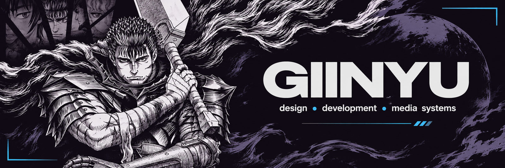

  

[**Portfolio**](https://g1nyu.github.io/) &nbsp;&nbsp;·&nbsp;&nbsp; [**Projects**](#selected-work) &nbsp;&nbsp;·&nbsp;&nbsp; [**Plugin catalog**](https://g1nyu.github.io/harbor-plugins/)

 

## About me

I'm **giinyu**, an independent builder with a background in graphic design. I work across media software, API integrations, performance optimization and interface design.

I like connecting applications that should work together, developing useful plugins, and making software feel as good as it looks. My process combines hands-on testing, iterative development, reproducible builds and AI-assisted engineering.

**Graphic design is my foundation, not a side interest.** I bring **10+ years of experience** in brand identity, print production, commercial product photography and visual communication, including professional work on packaging, catalogs, promotional graphics and community content. That background directly informs the typography, information hierarchy, visual assets and UX decisions in my software. [Design experience & CV](https://github.com/G1NYU/G1NYU/tree/main/cv).

 

## My toolkit

 

**Frontend & desktop**

  

**Systems & automation**

  

**Graphic design & production**

&nbsp;&nbsp;&nbsp;&nbsp;

  

**Media & AI workflows**

&nbsp;&nbsp;&nbsp;&nbsp;&nbsp;&nbsp;&nbsp;&nbsp;

  

**Desktop applications · APIs · Plugin development · Design systems · Performance · CI/CD**

  

## Selected work

 

### Tsugi (つぎ / 次)

**Native desktop media software · Extension ecosystems · Product design**

[Repository](https://github.com/G1NYU/TSUGI) &nbsp;·&nbsp; [Windows releases](https://github.com/G1NYU/TSUGI/releases) &nbsp;·&nbsp; [Source](https://github.com/G1NYU/TSUGI/tree/feature/tsugi-read-runtime)

 

An independent AGPL-3.0 fork of AIOStreams, expanded into a Windows-first media workspace for **Movies & TV, Music, Read and Vault**. Tsugi (次, *next*) expresses continuity between media and the idea of joining independent source ecosystems under one coherent interface.

- **Streaming architecture** — Stremio-compatible addons through AIOStreams and its Jellyfin-compatible API, with native mpv playback, server-driven catalogues, stream versions, subtitles and watch state.
- **Native audio engineering** — Rust/WebView2 bridge, yt-dlp and Deno transport, bounded replay and next-track prefetch, mpv audio filters, RMS-level telemetry and Web Audio analysis; full-window player layouts, reactive SVG/canvas-inspired visualizers, persistent album snapshots, track saves and queue management.
- **Extension-based reading** — In-app Mihon-compatible repository management, a pinned app-managed Suwayomi/Java runtime, GraphQL source discovery, continuous and paginated manga reading, isolated EPUB/PDF rendering with Readest/Foliate and PDF.js, and initial MAL/AniList tracker integrations.
- **Transfer orchestration** — Native persistent download queues, Aria2 Next JSON-RPC, TorBox API integration, concurrent transfers, progress, retry and cancellation, and local media-library handoff.
- **Design direction** — Original brush-stroke identity, Segoe UI Variable typography, Japanese minimalism and ma, Swiss editorial grids and Bauhaus-inspired functionalism. Six coordinated dark palettes, independent accents, shared design tokens, bespoke icons and original SVG brand illustrations.
- **Engineering & distribution** — Cargo, pnpm, Vitest, Playwright, GitHub Actions and PowerShell; native fixture tests, browser interaction and layout regressions, checksum-verified Windows x64 packaging, release gates and third-party license/source attribution.

**Release milestone** — Public portable Windows previews are available. The first non-preview release is undergoing final CI validation. Cold-start audio latency, live tracker sync and individual third-party source compatibility remain acceptance items.

 

### RE-Harbor

**Desktop development & media integrations**

[Repository](https://github.com/G1NYU/RE-Harbor) &nbsp;·&nbsp; [Experiments](https://github.com/G1NYU/RE-Harbor/pulls)

 

An experimental fork of Harbor, working across the React/TypeScript frontend, Tauri desktop environment and media integrations.

**[Refract integration](https://github.com/G1NYU/RE-Harbor/pull/4)** — API-key authentication, verified external-ID resolution, persistent retry queues, duplicate protection and inbound watched history. Manual watch logging is verified live; [automatic diary logging](https://github.com/G1NYU/RE-Harbor/tree/feature/snappy-startup-msi) with configurable viewing thresholds is in testing.

**[Snappy](https://github.com/G1NYU/RE-Harbor/pull/5)** — performance experiments with deferred initialization, lazy poster mounting, scroll/render profiling, regression tests and isolated Windows MSI builds.

The long-term Refract goal is a unified media tracker, with watchlist syncing next and games, books and manga dependent on future API capabilities.

**November 2026 milestone** — The Refract contribution was subsequently merged into Harbor as **PR #103** (merge commit `d3847d3`). The [VOID + Refract source branch](https://github.com/G1NYU/RE-Harbor/tree/feature/void-refract-2026-11-installer) includes later playback diary logging, watchlist add/remove work, and the custom music interface. The earlier milestones above document the integration's development stages; full two-way Refract-to-Harbor synchronization remains a separate goal.

**Builds and source continuity** — Published an [unsigned Windows x64 preview installer](https://github.com/G1NYU/RE-Harbor/releases/tag/reharbor-void-refract-2026-11-20) through a checksum-verified GitHub Actions packaging workflow. CI verified silent installation, bundled files, shortcuts and uninstallation; interactive Windows playback still requires device-level testing. Separately [archived Harbor 1.0.4 source through 21 November 2026](https://github.com/G1NYU/RE-Harbor/tree/archive/harbor-official-2026-11-21) for future upstream integration without overwriting the custom build.

 

### mihon-to-anymex

**Browser-based manga & anime library migration**

[Repository](https://github.com/G1NYU/mihon-to-anymex) &nbsp;·&nbsp; [Live converter](https://g1nyu.github.io/mihon-to-anymex/)

 

Built a client-side migration application for moving reading libraries between Mihon, Mangayomi and AnymeX, using a **Parse → Fetch → Build** pipeline rather than manual list reconstruction.

- **Import and parsing** — Accepts Mihon backup JSON exported via `backup.mihon.tools`, direct Mangayomi `.backup` files, headerless `Title,Status,ChaptersRead,ListName` CSV and batch title entry. Optional fields default to `PLANNING`, `0` and `Migrated`.
- **Metadata and export** — Looks up titles through the AniList GraphQL API, enriches metadata and generates restorable `.anymex` backups, with optional AnymeX templates and custom list names. File transformation runs in the browser; AniList queries require network access.
- **Reverse conversion** — Converts AnymeX manga entries into Mihon-compatible JSON, then uses `backup.mihon.tools` for the final `.mihon` export. The documented reverse path retains manga progress and status, skips anime and does not carry scores or notes; a matching Mihon source extension is still required.
- **Product features and maintenance** — English/Japanese interface, resumable lookups, batch import, compressed list-sharing URLs and a shareable cover-grid viewer. Earlier Python tooling informed the project but is not a dependency of the deployed web app.

**Compatibility boundaries** — Direct raw `.mihon` or Tachiyomi parsing is not verified; Komikku backups were explored without confirmed cross-version support. Mixed Mangayomi libraries exposed anime/manga classification concerns, with media-type counters and round-trip fidelity requiring further verification.

 

### Harbor Plugins

**Source development & distribution**

[Repository](https://github.com/G1NYU/harbor-plugins) &nbsp;·&nbsp; [Live catalog](https://g1nyu.github.io/harbor-plugins/)

 

An actively maintained fork with multilingual manga and Western comics source adapters, alongside the existing plugin infrastructure.

- TypeScript providers in a constrained worker runtime.
- HTML/JSON parsing, pagination, metadata normalization and image extraction.
- Real-client testing of search, catalogs and deep chapter archives.
- Separate main and testing catalogs, esbuild bundling, manifest validation and GitHub Pages deployment.

**Source reliability and catalog QA** — Investigated Kagane/KakaManga metadata, AllManga chapter-image failures, and an unusable Mangakakalot adapter. Weloma, WeebCentral and MangaFire were among the sources reported working in earlier tests. Source behavior can change; those observations describe historical testing rather than permanent compatibility guarantees. Catalog publishing, experimental source validation and user-facing distribution are treated as distinct workflows.

**Ebook integrations** — Published and exercised a Harbor ebook catalog, including entries from the *Inheritance Cycle*. Explored a possible **GinyuBooks** cleanup/alpha with Royal Road, Standard Ebooks and download-only Library Genesis support; a separate alpha release was not confirmed.

 

### VOID

**Interface design & performance**

[Native experiment](https://github.com/G1NYU/RE-Harbor/pull/6)

 

A custom Harbor theme exploring cinematic interfaces, deep Catppuccin Mocha palettes, bespoke navigation icons, refined typography and multilingual layouts.

Rich-effects experiments evolved into a lighter, static CSS approach guided by real scrolling tests and frame-timing diagnostics. VOID Native is a separate component-level theming prototype.

**Additional client work** — Prototyped centered branding, personalized greeting, larger streaming-service cards, flexible sidebar navigation, poster numbering and a full-page stream selector. Music and library explorations included expanded player views, playback controls, visualizer diagnostics, and CD/cassette-inspired artwork and motion. These span prototypes, tested revisions and design references; individual animations are not all verified as shipped.

**Beautiful software should feel beautiful to use.**

 

### Graphic design & visual identity

**Brand systems, print production, product photography & creative direction**

[CV & design experience](https://github.com/G1NYU/G1NYU/tree/main/cv) &nbsp;·&nbsp; [Portfolio](https://g1nyu.github.io/)

 

My design practice spans **more than a decade**, from identity development and print production to digital interfaces and community-facing artwork.

- **Identity and branding** — Logos, color and typography systems, brand guidelines, packaging and stationery. Selected work documented in my CV includes **E2A Communication**, **NEKO Coffee Shop & Lounge** and **Club Boba**.
- **Print and photography** — Business cards, brochures, flyers, letterheads, commercial product photography and e-commerce catalogs; hands-on prepress, CMYK preparation, and offset/digital production. Professional work includes **B2A Communication** and **Exotic City**.
- **Digital creative work** — Promotional showcases, community content and event posters, including community/content work at **Sai Wen Game Co**. This background carries through to VOID's iconography, interface composition, branding and motion experiments.
- **Tools** — Adobe Photoshop, Illustrator, InDesign, Lightroom and Premiere Pro, alongside Figma, SVG, HTML/CSS and frontend prototyping.

  

## What I do

**Graphic design & art direction** — Brand identity, logo and typography systems, packaging, layout, prepress/CMYK, print production, commercial photography, visual storytelling and digital content.

**Application development** — React, TypeScript, JavaScript, Next.js, HTML/CSS, Tauri/WebView2; desktop and web interfaces, state-driven components and application integration.

**Native systems & media engineering** — Rust, Cargo, WebView2 host bridges, mpv/libmpv, FFmpeg, yt-dlp, Deno and Web Audio; native playback integration, process lifecycle, bounded buffering, audio filters, measured audio-level visualizers and cross-workspace state.

**API & data integration** — REST, JSON, authentication, metadata matching, cursor pagination, synchronization, idempotency, retry queues and library migration. GraphQL, JSON-RPC, Jellyfin, Suwayomi, Eclipse manifests, LRCLIB, MAL/AniList and TorBox; provider adapters, extension-repository management and persistent collection metadata.

**Extensions & automation** — Node.js, Python, esbuild, Git and GitHub Actions; source adapters, data extraction, testing, CI/CD and packaging. pnpm workspaces, Cargo, Vitest, Playwright, native runtime provisioning, Windows release automation and SHA-256 package verification.

**Performance & visual design** — DevTools, frame timing, lazy loading, SVG and Figma; profiling, rendering efficiency, accessible dark interfaces and cohesive design systems.

I also work with Docker, Jellyfin, Stremio and AIOStreams for self-hosted media, LM Studio and MCP for local AI workflows, and scripting for repetitive tasks. Tsugi extends my desktop work into Rust native media runtimes, managed sidecars and multi-engine application architecture.

  

## Streaming integrations, configuration & diagnostics

Technical configuration and troubleshooting work across **AIOStreams and Stremio**: provider orchestration, stream filtering, metadata matching, language rules and reproducible JSON exports. These are personal configurations and experiments, **not claims of maintaining the upstream applications**.

| Technical area | Work and constraints |
| :--- | :--- |
| **Result selection and ranking** | Tuned 4K/1080p preferences, one-choice-per-resolution deduplication, stream-size limits, sorting and tiered add-on priorities. Handled HDR/Dolby Vision distinctions and separate cached-only versus uncached-fallback rules depending on the configuration. |
| **Audio and subtitle matching** | Built French-audio-only and French-first bilingual approaches, with French/Multi detection, VOSTFR and French/English subtitles, Japanese original audio for anime, and Korean audio for K-dramas. Separated audio labels from subtitle metadata rather than treating language as one field. |
| **Provider routing and passthrough** | Worked with Meteor, frenchio, Cometmid/Cometkuu passthrough, Ned's French-language formatter and StreamFusion duplicator exclusions; compared TorBox and AllDebrid routing while keeping each service's configuration distinct. |
| **Metadata and stream normalization** | Preserved custom regex/stream expressions while tuning title, year and episode matching, response formatting, early exits and result limits. Audited stale add-on IDs and cases where passthrough bypassed filters. |
| **Reliability and performance** | Investigated slow responses, dynamic fetching, add-on timeout budgets, HTTP 429 rate limits, IP-bound playback tokens, wrapped instances, proxy/self-hosting constraints, and next-episode precaching. These investigations did not establish a universal fix. |
| **Validation and UX** | Compared healthy and sparse JSON exports; diagnosed schema mismatches (`streams` vs `totalStreams`) and unsupported `fuzzy` matching; refined remote-friendly result selection, consistent resolution choices, and credential-free configuration exports. Prowlarr and Jackett were evaluated, not confirmed as deployed. |

**Configuration history** — These techniques were applied to distinct variants with different tradeoffs, including a general TV profile, a USA-focused profile, French-first and French-audio-only variants, plus profiles called `Ultimate`, `ice cream`, `finalFRENCH.json` and `aiostreams-config-tuned`. Cached-only behavior, subtitle fallbacks and provider exclusions were **not** intended to be identical across all profiles; final playback coverage for the tuned variant remains unverified.

**Documentation** — Drafted a French beginner guide to Stremio, add-ons and debrid, including safe sharing of sanitized configurations.

## More projects

| Project | Focus |
| :--- | :--- |
| [hondana (ほんだな)](https://github.com/G1NYU/hondana) | Personal Mihon fork; explored shelf-based reading-library organization (implementation not independently verified) |
| [g1nyu-shelf](https://github.com/G1NYU/g1nyu-shelf) | Personal media catalog using Next.js, AniList and Last.fm |
| [GINpuccin](https://github.com/G1NYU/GINpuccin) | Catppuccin-inspired YASB Reborn desktop customization |
| [SignalStack](https://github.com/G1NYU/SignalStack) | Interactive history visualization, inspired by Spotify Wrapped |
| [tools-and-media-library](https://github.com/G1NYU/tools-and-media-library) | Curated resource directory and automated publishing |
| [wc2026-value-bracket](https://github.com/G1NYU/wc2026-value-bracket) | Squad market-value-driven tournament simulation |

  

## Libraries, catalogs & other experiments

**Manga-library interoperability** — The featured [mihon-to-anymex](https://github.com/G1NYU/mihon-to-anymex) converter grew from Python import experiments into a browser-based AniList-assisted migration workflow. Its documented v2 input paths are Mihon JSON via `backup.mihon.tools`, direct Mangayomi `.backup`, and CSV; direct raw Mihon/Tachiyomi backup parsing was explored but **not verified as shipped**. Komikku backup compatibility was tested without confirmed version coverage, while a Mangayomi anime-as-manga classification report prompted requests for separate media counts. Not every proposed fix or input format is verified as released.

**Readers and library tools** — Work with Komikku was personal reading and backup testing, not a claim of contributing to Komikku's code. Maintained the [hondana](https://github.com/G1NYU/hondana) Mihon fork and experimented with custom shelves. Also worked with a generated Cubari manga-source repository, and configured Jellyfin as a personal media library; specific server deployment details are not public here.

**Harbor client QA** — Tested v1.0.1-beta manga and ebook loading, including intermittent BatCave and Royal Road behavior, verification prompts, absent covers and failed series navigation. Mihon backup import/export was requested as a priority, not established as a shipped Harbor feature.

**Community tools and prototypes** — The [tools-and-media-library](https://github.com/G1NYU/tools-and-media-library) / Sentai toolbox concept is an anonymous, FMHY-inspired directory of shared community resources, with concise listings, GitHub star counts and optional curated picks. Earlier TVFlix collection-builder ideas informed explorations around Nuvio accounts and collections; a standalone TVFlix repository was not verified. Other work includes personal web presence and a portfolio/CV, a blog repository with unverified contents, and private TypeScript/Vly experiments without a public feature specification.

**Additional areas** — PC and audio troubleshooting, local AI/agent experiments, Office/Excel automation, content management and graphic/web design. These describe areas of practice rather than individually verified released products.

## GitHub activity

 

  

## Find me

 

&nbsp;&nbsp;
&nbsp;&nbsp;

  

[Portfolio](https://g1nyu.github.io/) &nbsp;·&nbsp; [YouTube](https://www.youtube.com/@ginyuTV) &nbsp;·&nbsp; [Discord](https://discord.gg/giinyu)

  

**giinyu.**

