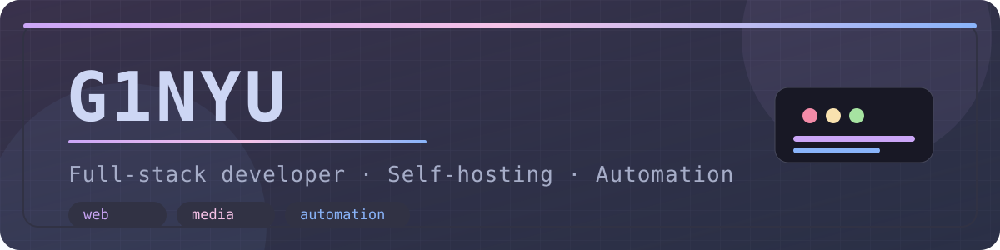

<b>INDEPENDENT DEVELOPMENT &nbsp; / &nbsp; GRAPHIC DESIGN BACKGROUND &nbsp; / &nbsp; OPEN SOURCE</b>

[Selected work](#selected-work) &nbsp;·&nbsp; [Capabilities](#capabilities) &nbsp;·&nbsp; [Project archive](#project-archive) &nbsp;·&nbsp; [Portfolio](https://g1nyu.github.io/)

 

## Form follows function.

I'm **giinyu** — an independent builder with a background in graphic design, working at the intersection of **media software, API integrations, performance optimization and interface design**.

I extend the media ecosystem by connecting applications that should work together, building source plugins, improving desktop responsiveness, and designing interfaces that feel good to use.

My process combines hands-on testing, iterative development, reproducible builds and AI-assisted engineering. Good design is not just how something looks. It's how it behaves.

 

## Selected work

01 — 03 &nbsp; / &nbsp; ACTIVE PROJECTS &amp; EXPERIMENTS

 

An experimental fork of Harbor, working across the React/TypeScript frontend, Tauri desktop environment and media integrations.

**[Refract integration ↗](https://github.com/G1NYU/RE-Harbor/pull/4)** &nbsp; EXPERIMENTAL · LIVE MANUAL LOGGING VERIFIED

API-key authentication, verified external-ID resolution, persistent watch-event queues, duplicate protection and inbound watched history. [Automatic diary logging](https://github.com/G1NYU/RE-Harbor/tree/feature/snappy-startup-msi) adds configurable viewing thresholds using existing playback events; live playback validation is still in progress.

**[Snappy ↗](https://github.com/G1NYU/RE-Harbor/pull/5)** &nbsp; PERFORMANCE EXPERIMENT

Deferred initialization, lazy poster mounting, scroll/render diagnostics, regression tests and isolated Windows MSI builds.

Long-term: a unified Refract media tracker, with watchlist synchronization next and games, manga and books dependent on future API capabilities.

TypeScript &nbsp; / &nbsp; React &nbsp; / &nbsp; Tauri &nbsp; / &nbsp; REST &nbsp; / &nbsp; GitHub Actions

 

An actively maintained fork with multilingual manga and Western comics source adapters, alongside the existing plugin infrastructure.

- TypeScript provider implementations in a constrained worker runtime.
- HTML/JSON parsing, pagination, metadata normalization, cover resolution and reader image extraction.
- Real-client testing of search, catalog loading and deep chapter archives.
- Separate testing and main catalogs, esbuild bundling, manifest validation and GitHub Pages deployment.

**[Source repository ↗](https://github.com/G1NYU/harbor-plugins)** &nbsp;·&nbsp; **[Live plugin catalog ↗](https://g1nyu.github.io/harbor-plugins/)**

TypeScript &nbsp; / &nbsp; esbuild &nbsp; / &nbsp; Metadata &nbsp; / &nbsp; CI/CD

 

A custom Harbor theme project exploring cinematic media interfaces, restrained Catppuccin Mocha palettes, bespoke navigation icons, typography and multilingual layouts.

Rich-effects experiments evolved into a lightweight static CSS approach, guided by real scrolling tests and frame-timing diagnostics. [VOID Native](https://github.com/G1NYU/RE-Harbor/pull/6) explores component-level theming as an alternative to runtime overrides; it remains a separate prototype.

**A beautiful interface is only worth keeping if it remains responsive.**

Art direction &nbsp; / &nbsp; CSS &nbsp; / &nbsp; SVG &nbsp; / &nbsp; Design systems &nbsp; / &nbsp; Profiling

 

## Capabilities

THE TOOLKIT &nbsp; / &nbsp; DESIGN × DEVELOPMENT

<table>
<tr>
<td width="50%" valign="top">01 / BUILD <h3>Application development</h3>TypeScript · JavaScript · React · Next.js · HTML · CSS · Tauri/WebView2  Desktop UI, web interfaces, state-driven components and application integration.</td>
<td width="50%" valign="top">02 / CONNECT <h3>API &amp; data integration</h3>REST · JSON · authentication · metadata APIs · synchronization  Identity matching, cursor pagination, idempotency, retry queues and data migration.</td>
</tr>
<tr>
<td width="50%" valign="top">03 / EXTEND <h3>Extensions &amp; automation</h3>Node.js · Python · esbuild · Git · GitHub Actions  Source adapters, structured data extraction, testing, CI/CD and packaging.</td>
<td width="50%" valign="top">04 / REFINE <h3>Performance &amp; design</h3>DevTools · frame timing · lazy loading · SVG · Figma  Profiling, rendering efficiency, accessible dark UI and cohesive design systems.</td>
</tr>
</table>

I also work with self-hosted media workflows (Docker, Jellyfin, Stremio and AIOStreams), local AI tooling (LM Studio and MCP), and automation scripts. Tauri/Rust-based applications are an active area of exploration.

 

## Project archive

OTHER SELECTED WORK &nbsp; / &nbsp; TOOLS, WEB &amp; DESIGN

| Project | Focus |
| :--- | :--- |
| [mihon-to-anymex ↗](https://github.com/G1NYU/mihon-to-anymex) | Manga-library migration and AniList metadata matching |
| [g1nyu-shelf ↗](https://github.com/G1NYU/g1nyu-shelf) | Personal media catalog using Next.js, AniList and Last.fm |
| [GINpuccin ↗](https://github.com/G1NYU/GINpuccin) | Catppuccin-inspired YASB Reborn desktop customization |
| [SignalStack ↗](https://github.com/G1NYU/SignalStack) | Interactive history visualization, inspired by Spotify Wrapped |
| [tools-and-media-library ↗](https://github.com/G1NYU/tools-and-media-library) | Curated resource directory and automated publishing |
| [wc2026-value-bracket ↗](https://github.com/G1NYU/wc2026-value-bracket) | Squad market-value-driven tournament simulation |

 

## Activity

 

## Connect

<a href="https://github.com/G1NYU">GitHub ↗</a> &nbsp;·&nbsp;
<a href="https://g1nyu.github.io/">Portfolio ↗</a> &nbsp;·&nbsp;
<a href="https://www.youtube.com/@ginyuTV">YouTube ↗</a> &nbsp;·&nbsp;
<a href="https://instagram.com/icecoldwill">Instagram ↗</a> &nbsp;·&nbsp;
<a href="https://discord.gg/giinyu">Discord ↗</a>

 

G1NYU &nbsp; / &nbsp; FORM. FUNCTION. FLOW. 
Designed and built with intent.

